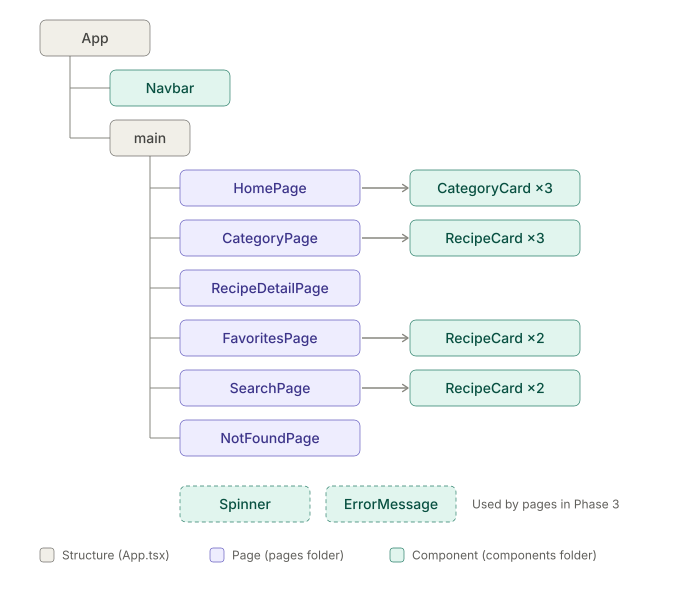

# STUDY GUIDE — Recipe Discovery App (SBA 416)

For learning: what words mean, why they're called that, and why we did each step.
(Tasks are in TODO.md. README/reflection material is in NOTES.md.)

---

## Glossary (and why things are called what they are)

| Word | Plain meaning | Why it's called that |
|---|---|---|
| **Repository (repo)** | A project folder that Git tracks the history of | "Repository" = a storage place. It stores every saved version. |
| **Clone** | Download a copy of a GitHub repo to your computer, already linked to GitHub | You make an identical twin of it. |
| **origin** | Git's nickname for "the GitHub copy" of your repo | It's where your local copy *originated* from. |
| **Commit** | A saved snapshot of your files, with a message | Like "committing" to a decision: this version is now on the record. |
| **Stage (`git add`)** | Pick which changes go into the next commit | Like staging items before a photo: you set them up first, then snap. |
| **Push** | Upload your commits to GitHub | You push changes *away* from your machine. (Pull = bring them in.) |
| **Upstream (`-u`)** | Tells Git which GitHub branch your local branch goes with | The remote copy is "up the stream" your code flows to. |
| **Branch** | A separate line of work so you can try things without breaking main | Like a tree branch growing off the trunk (`main`). |
| **Directory** | A folder | Older computer word: a *directory* lists files, like a phone directory. |
| **`cd` / `mkdir` / `rm`** | Change directory / make directory / remove (delete) | Short for exactly what they do. |
| **`touch`** | Bash command that creates a new, empty file (`touch src/types/Category.ts`) | Its original job is to "touch" a file (update its last-changed time without changing it). If the file doesn't exist, it creates it. |
| **`ls`** | Bash command that lists what's inside a folder | Short for "list" |
| **npm** | Node Package Manager: downloads code libraries other people wrote | It manages "packages" (bundles of code). |
| **package.json** | The project's ID card: name, scripts, list of libraries it needs | It describes the *package* (your project). |
| **node_modules** | The folder where npm puts downloaded libraries. Huge. Never commit it. | The modules Node uses. |
| **.gitignore** | A list of files/folders Git should pretend don't exist | Git *ignores* whatever's listed. |
| **Vite** | A tool that runs a dev server and builds your app | French for "fast" (pronounced "veet"). |
| **Scaffold** | Generate the starting files for a project | Like scaffolding on a building: the frame you build on. |
| **Dev server** | A tiny local website (`localhost:5173`) that reloads when you save | "localhost" = this computer. |
| **DevTools / Console** | Browser tools (F12). The Console shows errors in red. | Tools for developers; "console" comes from old computer control panels. |
| **TypeScript (TS)** | JavaScript plus labels describing what kind of data things are | It adds *types* to JavaScript. |
| **.tsx** | A TypeScript file that contains JSX (HTML-looking code in React) | TS + JSX = TSX. |
| **IntelliSense** | VS Code's auto-suggest and auto-complete | "Intelligent" + "sense": it senses what you're probably typing |
| **Component** | A reusable piece of UI, written as a function that returns JSX | It's a *component* part of the whole page, like a car part. |
| **SPA** | Single Page Application: one HTML page, React swaps the content | Browser never loads a whole new page. |
| **Route** | A URL path mapped to a page component | The *route* you travel to reach a page. |
| **Hook** | A React function starting with `use` that gives components extra powers (state, effects) | You "hook into" React's features. |
| **Custom hook** | Your own function starting with `use` that bundles hooks together for reuse | Same idea, written by you. |
| **Context** | A way to share data with any component without passing props through every level | It's the shared "context" all components live in. |
| **Prop drilling** | Passing data down through components that don't need it, just to reach one that does | Drilling down layer by layer. Context fixes it. |
| **localStorage** | Browser storage that survives refresh and closing the browser | It's *local* (on this computer) *storage*. |
| **API / endpoint** | A URL that returns data (JSON) instead of a web page | Endpoint = the end of the line where you request data. |
| **Top-down** | Build the big outer pieces first, then fill in the smaller ones | You start at the *top* of the component tree and work *down*. |

---

## WHY notes (by phase)

### Overall approach: Top-down, components first, routes last
- Build the component structure first: App at the top, then Navbar and pages, then the small pieces (cards, spinner) as placeholders.
- Then fill in pages one at a time with real data.
- Add routing LAST to connect the pages. (Instructor's guidance.)
- Make a component or hook **when a page needs it**, not ahead of time.
- When code repeats, pull it out into something reusable (e.g., `useFetch`).
- Why: you always have a working app, and you never build parts you don't use. (Instructor's recommendation.)

### Phase 0: Setup
- **Why clone instead of making a new folder?** Cloning sets up the link to GitHub (`origin`) automatically, so `git push` just works.
- **Why `npm create vite@latest .`?** The `.` means "right here," so Vite doesn't make a folder inside your repo folder.
- **Why Vite?** It's the standard modern way to start a React app. (Create React App is retired.)
- **Why TypeScript?** Our course uses it, and it catches mistakes (like typos in API field names) before you run the code. The SBA doesn't require it.
- **Why react-router-dom?** React by itself has no idea about URLs. This library maps URLs to components, which the SBA's five routes need.
- **Why `npm install` after scaffolding?** Vite only writes the files. `npm install` reads package.json and downloads what's listed into `node_modules`.
- **Why is `node_modules` in `.gitignore`?** It's huge and anyone can recreate it with `npm install`. Only your code goes on GitHub.
- **Why simple commit messages?** A commit message should say what you did in plain words so anyone (including future you) understands the history.

### Phase 1: Clean up + folders
- **Why delete the demo?** It's leftover sample code. Keeping it clutters the project and confuses graders.
- **Why `box-sizing: border-box`?** It makes an element's width include its padding and border, so layouts do what you expect. Almost every project starts with this.
- **Why these folders?**
  - `components/` = reusable building blocks (Navbar, RecipeCard, Spinner)
  - `pages/` = one component per route/URL (Home, Favorites...)
  - `hooks/` = custom hooks (useFetch, useLocalStorage)
  - `context/` = global shared state (FavoritesContext)
  - `types/` = TypeScript descriptions of the API data
  - Splitting by job makes things easy to find and is how real teams organize React apps.
- **Why don't empty folders show on GitHub?** Git tracks files, not folders. A folder appears once it has a file in it.
- **Why does `index.html` matter so much?** It's the one real page of the SPA. It has two key pieces:
  - `<div id="root"></div>`: an empty box. React draws your entire app inside it ("root" = where the component tree starts).
  - `<script type="module" src="/src/main.tsx">`: the line that loads React. Without it, none of your code runs.
  - Missing either one = blank page.
- **Debugging habit:** blank/black page = check the Console (F12) and the terminal for red errors first. Also check for unsaved files (white dot on the VS Code tab).


### Phase 2: Component structure
- **Branches:** not used in this project (our class works directly on `main`). Just commit and push after each step that works.
- **What's a placeholder?** A component that just shows its own name for now. It proves the piece exists and is in the right spot before you spend time on what's inside.
- **Why build the structure first?** You see the whole "family tree" of the app working before any details. Then you fill in one branch of the tree at a time, and you always know where a new piece fits.
- **Component tree:** components live inside other components, like boxes in boxes:

  

  Text version:
  ```
  App
  ├── Navbar
  └── main
      ├── HomePage → CategoryCard (many)
      ├── CategoryPage → RecipeCard (many)
      ├── RecipeDetailPage
      ├── FavoritesPage → RecipeCard (many)
      ├── SearchPage → RecipeCard (many)
      └── NotFoundPage
  (Spinner and ErrorMessage get used inside pages while loading / on errors)
  ```
  - "Parent" = the outer component. "Child" = a component used inside it. HomePage is the parent of CategoryCard.
- **pages vs components folders:** a *page* is a whole screen (one per URL later). A *component* is a smaller reusable piece used on pages.
- **Why does RecipeCard get reused?** Category, Favorites, and Search all show lists of recipes. Write the card once, use it in three places. That's the point of components.
- **Why do files start with a capital letter (`HomePage.tsx`)?** React requires components to start with a capital letter. That's how it tells your components (`<HomePage />`) apart from normal HTML tags (`<div>`). Naming the file the same way keeps it consistent.
- **Which file imports what?** Rule: **import a component in the file that uses it**, and nowhere else.
  - App uses Navbar + the 6 pages → App imports those 7.
  - HomePage uses CategoryCard → HomePage imports CategoryCard.
  - Category/Favorites/Search pages use RecipeCard → each of them imports RecipeCard.
  - App doesn't import the cards, because App never uses them directly. Each file only needs to know about its own direct children.
- **IntelliSense added `import React from "react"` — do I need it?** No. Old React (before v17) needed it in every file. Modern React handles JSX on its own. `ReactDOM` is only needed once, in main.tsx, to start the app (we already use `createRoot` there). Unused imports get flagged by TypeScript, so delete them.
  - *IntelliSense* = VS Code's auto-suggest/auto-complete. "Intelligent" + "sense": it guesses what you mean. Helpful, but it sometimes guesses wrong or uses old habits, so always read what it adds.
- **What's `export default`?** It makes the component available to other files. `import HomePage from './pages/HomePage'` grabs it.
- **What's `<main>`?** An HTML tag meaning "the main content of the page." It's like a `<div>` but tells screen readers and graders what it is (this is called *semantic* HTML: tags that describe their meaning).
- **`<section>` vs `<div>`:** both are invisible boxes that group things. `<div>` means nothing in particular. `<section>` means "a chunk of content with its own heading," so it fits each page (an `<h1>` + content). Use `<div>` when a box is only for layout/styling.
  - Semantic tags used so far: `<nav>` (navigation), `<main>` (main content), `<section>` (a headed chunk). "Semantic" = has meaning.
- **Why 3 CategoryCards?** No special reason. Just placeholder copies to show one component can be reused. In Phase 3 we replace them with `.map()`, which makes one card per category from the API (about 14).
- **How to read the tree:** a line going down = "is inside of." An arrow to the right = "this page uses that component." Dashed boxes = built but not used until later.
- **Why stack all pages in App for now?** Temporary, just to see every page render. Routing (Phase 9) will replace this so only one page shows at a time.

### Phase 3: Home page (real data)
- **API response shape:** `categories.php` sends back an object with ONE key, `categories`, holding a list (array) of category objects. So the list is at `data.categories`, not `data`.
- **Why the weird names (`strCategory`, `idCategory`)?** TheMealDB's creator put the type at the front: `str` = string (text), `id` = identifier. It's an old naming habit. We use their names exactly so the data matches.
- **What's an `interface`?** A TypeScript description of what an object looks like: which fields it has and what type each one is. It doesn't do anything when the app runs. It just lets VS Code warn you if you misspell a field or use one that doesn't exist.
- **Why `import type`?** It tells TypeScript "this import is only a type description, not real code." Types get erased when the app runs, so this keeps the final app clean. Our project settings require it for types.
- **`useState`:** gives a component a memory. `const [categories, setCategories] = useState<Category[]>([])` means:
  - `categories` = the current value (starts as an empty list `[]`)
  - `setCategories` = the function you call to change it. Changing it makes React redraw the page.
  - `<Category[]>` = "this will hold a list of Category objects" (`[]` after a type = list of them)
  - Called "state" because it's the current *state* (condition) of the component.
- **The 3 statuses of a fetch (restaurant ticket version):** pending/cooking = **loading** → show `Spinner`. Something went wrong = **error** → show `ErrorMessage`. Complete = **success** → show the real content.
  - Note: "404" is one specific kind of error ("not found"). Errors can also be no internet, server down (500), etc. So we call it "error" in general.
- **Why three pieces of state (data, loading, error)?** A fetch has 3 possible situations: still waiting, it failed, or it worked. Each one needs different things on screen.
- **`useEffect`:** runs code *after* the component shows on screen. Used for "side effects" — things outside drawing the page, like fetching data. ("Effect" = a side effect.)
  - The `[]` at the end is the **dependency array**: the list of values that should make the effect run again when they change. Empty = run only once, when the page first appears.
- **`async` / `await`:** fetching takes time. `await` means "wait here until this finishes, then continue." A function that uses `await` must be marked `async`.
- **`try` / `catch` / `finally`:** `try` = attempt this. `catch` = if anything goes wrong, run this instead (so the app doesn't crash). `finally` = run this no matter what (turn loading off either way).
- **Why check `response.ok`?** `fetch` only fails by itself if there's no internet. If the server answers "error 500," fetch still thinks it worked. `response.ok` is true only for good answers, so we throw our own error for bad ones.
- **Why `err instanceof Error`?** In JavaScript *anything* can be thrown (`throw "oops"`, `throw 42`), so TypeScript marks a caught error as `unknown`. `instanceof` checks "is it a real Error object?" before reading `.message`. ("Instance" = one of; "is err one of the Error kind?")
- **Why `err.message` instead of a hardcoded message?** It shows the *real* reason it failed (no internet, bad status), which helps users and debugging. A hardcoded message hides the cause.
- **Ternary operator `a ? b : c`:** a one-line if/else. "Is a true? If yes → b, otherwise → c." "Ternary" = three parts.
  - `setError(err instanceof Error ? err.message : "An unknown error occurred")`
- **Shadowing:** giving an inner variable the same name as an outer one (e.g., naming the caught error `error` when there's already an `error` state). The inner one "casts a shadow" over the outer one, hiding it inside that block. It works, but it's confusing to read. Use a different name like `err`.
- **Props ("properties"):** how a parent hands information INTO a child component. Like writing details on a ticket for the kitchen. Same idea as HTML attributes (``).
  - Parent passes: `<ErrorMessage message={error} />` — curly braces pass the variable's *value*; quotes would pass the literal word.
  - Child describes what it accepts with an interface named `ComponentNameProps`: `interface ErrorMessageProps { message?: string }`
  - Child receives: `function ErrorMessage({ message }: ErrorMessageProps)`
- **Destructuring `{ message }`:** unpacking just the item you need from the props "box" so you can write `message` instead of `props.message`.
- **Optional prop `?`:** `message?: string` means the parent *may* leave it out. If they do, it's `undefined` (empty).
- **Default value:** `{ message = "Something went wrong" }` = "if no message was passed, use this instead." Pairs well with an optional prop.
- **Test the error state on purpose:** misspell the API URL, save, see if ErrorMessage shows. Then fix it. (Proves your error handling actually works.)
- **Early return:** `if (loading) return <Spinner />` stops the function there and shows only the spinner. The rest only runs when loading is done and there's no error.
- **Why does the fetch run twice in the Network tab?** `<StrictMode>` in main.tsx runs effects twice in development on purpose, to help catch bugs. It doesn't happen in the real (built) app. Normal.

### Phase 9: Routing (notes saved for later)
- **My list of places a user can go (Aubrey's brainstorm → becomes the routes):**
  | What the user is doing | Page | URL (route) |
  |---|---|---|
  | Being at the home page / looking at categories | HomePage | `/` |
  | Looking at the recipes in a category | CategoryPage | `/category/:categoryName` |
  | Reading recipe details | RecipeDetailPage | `/recipe/:recipeId` |
  | Looking at the favorites page | FavoritesPage | `/favorites` |
  | Typing in the nav bar → searching for a recipe | Navbar → SearchPage | `/search?query=...` |
  | Going somewhere that doesn't exist | NotFoundPage | `*` (anything else) |
- **Why `BrowserRouter` goes in main.tsx?** It has to wrap the *whole* app so every component can use routing. main.tsx is the very top. "Browser" because it uses the browser's real address bar.
- **`Routes` and `Route`:** `Routes` looks at the current URL and picks the ONE `Route` that matches. Each `Route` says "this path → show this component."
- **What's `:categoryName`?** The colon means "this part of the URL is a variable." `/category/Seafood` and `/category/Dessert` both match `/category/:categoryName`. That's a **dynamic route**. `/favorites` is a **static route** (always the same). We read the variable with `useParams` ("params" = parameters, the variable pieces of the URL).
- **What's `path="*"`?** `*` means "anything." Listed last as a catch-all: if nothing else matches, show the 404 page. (404 = the web's code for "not found.")
- **Why does the Search route have no `?query` in its path?** The part after `?` is the **query string**. It isn't part of the path, so the route is just `/search`. We read `?query=...` with `useSearchParams`.
